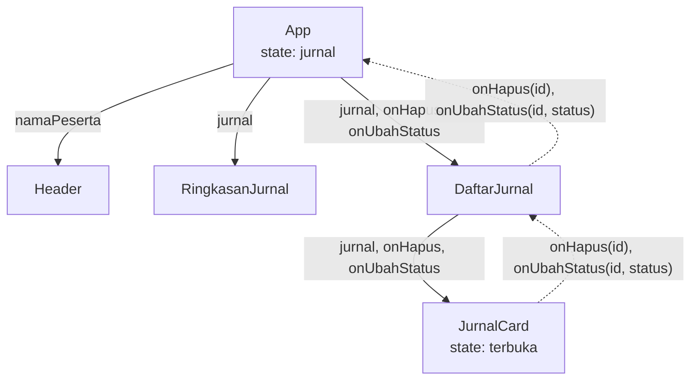

# Magang Web

Aplikasi jurnal harian magang: peserta menulis jurnal, mentor me-review dengan catatan. Dibuat dengan React, TypeScript, dan Vite.

## Cara Menjalankan

```bash
git clone <url-repo>
cd magang-web
npm install
npm run dev
```

Perintah lain: `npm run lint` dan `npm run build`.

## Fitur

- Tambah jurnal lewat form dengan validasi di sisi klien (kolom opsional yang kosong disimpan sebagai `null`)
- Hapus jurnal dengan konfirmasi dua langkah
- Saklar peran Peserta dan Mentor. Mentor dapat me-review: status "sudah" wajib disertai catatan minimal 5 karakter, status "belum" boleh tanpa catatan
- Filter status dan pencarian kegiatan (ditunda 300 ms), pintasan `/` untuk memfokuskan pencarian
- Ringkasan total, sudah, dan belum direview dihitung dari data
- Data bertahan setelah muat ulang lewat localStorage dengan pemeriksaan bentuk data
- Judul tab menampilkan jumlah jurnal belum direview
- Dua keadaan kosong yang berbeda: belum ada jurnal, dan hasil filter kosong

## Rencana Pengembangan

- Menyambungkan aplikasi ke API untuk mengambil dan menyimpan jurnal, menggantikan data tiruan dan localStorage

## Struktur Folder

```
src/
├── components/
│   ├── ui/        Button, Alert, Kartu, Badge
│   ├── jurnal/    FormJurnal, DaftarJurnal, JurnalCard, PanelReview, RingkasanJurnal,
│   │              StatusBadge, PencarianJurnal, FilterJurnal
│   └── layout/    Header, SaklarPeran
├── hooks/         useLocalStorage, usePenundaan
├── data/          jurnal (data tiruan)
├── types/         peserta, jurnal
├── utils/         cx, format, validasiJurnal, guard, daftar
├── App.tsx
└── main.tsx
```

## Keputusan Desain

- **State jurnal diangkat ke `App`.** Ringkasan, daftar, dan judul tab membaca satu sumber data, sehingga tidak mungkin tidak sinkron.
- **Hasil filter, urutan, dan angka ringkasan adalah data turunan.** Dihitung saat render dan tidak disimpan sebagai state, jadi tidak ada salinan basi.
- **Validasi berupa fungsi murni** (`validasiFormJurnal`, `validasiReview`) yang terpisah dari komponen. Aturannya meniru DTO di backend, sedangkan server tetap penentu akhir.
- **Data dari localStorage diperiksa dengan type guard, bukan `as`.** Tipe TypeScript hilang saat runtime, dan isi localStorage bisa diubah pengguna.

---

## Efek atau bukan?

| Kasus | Jawaban | Alasan |
|---|---|---|
| Menghitung jumlah jurnal belum direview | Data turunan | Bisa dihitung dari `jurnal` saat render, misalnya `jurnal.filter(...).length`. Tidak perlu state atau efek. |
| Mengosongkan form setelah jurnal berhasil disimpan | Event handler | Terjadi karena pengguna menekan Simpan. Reset state dipanggil di handler yang sama, bukan di efek yang memantau. |
| Menyimpan jurnal ke localStorage setiap berubah | Efek | Menyinkronkan state dengan sistem di luar React (penyimpanan browser), seperti di `useLocalStorage`. |
| Mengatur judul tab sesuai jumlah jurnal | Efek | `document.title` ada di luar React dan perlu disinkronkan setelah render. |
| Menampilkan "Berhasil disimpan" setelah Simpan ditekan | Event handler | Respons langsung terhadap aksi pengguna. Pesan diatur di handler, bukan efek yang menunggu perubahan state. |
| Mengurutkan daftar dari terbaru | Data turunan | Dihitung saat render dengan `[...jurnal].sort(...)`, tanpa state tambahan. |

---

## Catatan Belajar

<details>
<summary>Apa beda props, state, dan data turunan?</summary>


Props adalah data yang diberikan komponen induk dan hanya boleh dibaca, misalnya jurnal yang dikirim DaftarJurnal ke JurnalCard. 
State adalah data milik komponen itu sendiri yang bisa berubah lewat setter dan memicu tampilan digambar ulang, misalnya terbuka di JurnalCard yang menentukan apakah detail tampil. 
Data turunan adalah nilai yang dihitung dari props atau state yang sudah ada saat render, misalnya adaDetail di JurnalCard, yang dihitung dari props jurnal untuk menentukan apakah tombol detail ditampilkan.

<details>
<summary>Contoh dari aplikasi jurnalmu untuk masing-masing.</summary>

Props adalah jurnal (dan onHapus) yang diterima di parameter fungsi:
```tsx
export function JurnalCard({ jurnal, onHapus }: JurnalCardProps)
```
Nilainya dikirim oleh induknya:
```tsx
<JurnalCard jurnal={j} />
```

---

State adalah terbuka, di baris pertama dalam JurnalCard:

```tsx
const [terbuka, setTerbuka] = useState(false)
```

Nilainya diubah lewat setter saat tombol diklik:

```tsx
onClick={() => setTerbuka((t) => !t)}
```

---

Data turunan adalah jumlahLampiran dan adaDetail, tepat di bawah state:

```tsx
const jumlahLampiran = jurnal.lampiran?.length ?? 0;
const adaDetail =
Boolean(jurnal.hambatan) || Boolean(jurnal.catatanMentor) || jumlahLampiran > 0;
```
</details>
</details>

<details>
<summary>Gambar aliran data</summary>



Garis penuh adalah data yang turun lewat props, sedangkan garis putus-putus adalah peristiwa yang naik lewat callback. `App` adalah pemilik tunggal data jurnal. Peristiwa klik naik sampai ke `App`, yang mengubah state dan membuat semua komponen anak menerima data terbaru.
</details>

<details>
<summary>Mengapa Key Harus Berupa ID Unik?</summary>

React mengenali item lewat key. Kalau key berupa indeks, yang dikenali hanya posisinya, bukan identitas item. 
Setelah “Satu” dihapus, “Dua” pindah ke indeks 0 dan memakai key yang tadinya milik “Satu”, sehingga React memakai ulang elemen li lama beserta isi input-nya dan AAA menempel di samping “Dua”. 
Dengan key berupa nilai unik dan stabil, React tahu elemen milik “Satu” memang dibuang dan elemen “Dua” dipertahankan beserta isinya. Itu sebabnya key harus berupa ID dari data, bukan indeks.
</details>