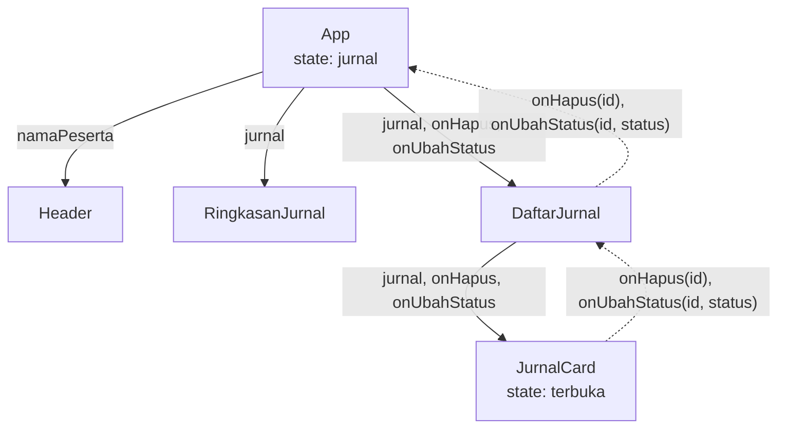

# Magang Web

Halaman statis untuk melihat jurnal harian peserta magang beserta ringkasan status review. Dibuat dengan React, TypeScript, dan Vite.

## Cara Menjalankan

```bash
git clone <url-repo>
cd magang-web
npm install
npm run dev
```

Perintah lain: `npm run lint` dan `npm run build`.

## Struktur Folder

```text
src/
├── components/
│ ├── ui/ Button, Alert, Badge, Kartu (generik)
│ ├── jurnal/ JurnalCard, DaftarJurnal, StatusBadge, RingkasanJurnal
│ └── layout/ Header
├── data/ data tiruan (sementara)
├── types/ peserta.ts, jurnal.ts
├── utils/ cx.ts, format.ts
├── pages/ GaleriKomponen
└── App.tsx menyusun halaman
```

## Keputusan Desain

- **Komponen ui dipisah dari komponen jurnal.** Komponen ui tidak mengenal istilah jurnal sehingga bisa dipakai ulang di fitur lain, sedangkan komponen jurnal yang memakainya.
- **Ringkasan dihitung dari array saat render.** Angka total, sudah, dan belum direview tidak disimpan terpisah, jadi tidak bisa tidak sinkron dengan datanya.
- **Pengurutan memakai salinan array.** `[...jurnal].sort(...)` menjaga data asli tidak berubah, sehingga komponen tetap murni.

## Catatan Belajar

<details>
<summary>Apa beda props, state, dan data turunan?</summary>


Props adalah data yang diberikan komponen induk dan hanya boleh dibaca, misalnya jurnal yang dikirim DaftarJurnal ke JurnalCard. 
State adalah data milik komponen itu sendiri yang bisa berubah lewat setter dan memicu tampilan digambar ulang, misalnya terbuka di JurnalCard yang menentukan apakah detail tampil. 
Data turunan adalah nilai yang dihitung dari props atau state yang sudah ada saat render, misalnya adaDetail di JurnalCard, yang dihitung dari props jurnal untuk menentukan apakah tombol detail ditampilkan.

<details>
<summary>Contoh dari aplikasi jurnalmu untuk masing-masing.</summary>

Props adalah jurnal (dan onHapus) yang diterima di parameter fungsi:
```tsx
export function JurnalCard({ jurnal, onHapus }: JurnalCardProps)
```
Nilainya dikirim oleh induknya:
```tsx
<JurnalCard jurnal={j} />
```

---

State adalah terbuka, di baris pertama dalam JurnalCard:

```tsx
const [terbuka, setTerbuka] = useState(false)
```

Nilainya diubah lewat setter saat tombol diklik:

```tsx
onClick={() => setTerbuka((t) => !t)}
```

---

Data turunan adalah jumlahLampiran dan adaDetail, tepat di bawah state:

```tsx
const jumlahLampiran = jurnal.lampiran?.length ?? 0;
const adaDetail =
Boolean(jurnal.hambatan) || Boolean(jurnal.catatanMentor) || jumlahLampiran > 0;
```
</details>
</details>

<details>
<summary>Gambar aliran data</summary>



Garis penuh adalah data yang turun lewat props, sedangkan garis putus-putus adalah peristiwa yang naik lewat callback. `App` adalah pemilik tunggal data jurnal. Peristiwa klik naik sampai ke `App`, yang mengubah state dan membuat semua komponen anak menerima data terbaru.
</details>

<details>
<summary>Mengapa Key Harus Berupa ID Unik?</summary>

React mengenali item lewat key. Kalau key berupa indeks, yang dikenali hanya posisinya, bukan identitas item. 
Setelah “Satu” dihapus, “Dua” pindah ke indeks 0 dan memakai key yang tadinya milik “Satu”, sehingga React memakai ulang elemen li lama beserta isi input-nya dan AAA menempel di samping “Dua”. 
Dengan key berupa nilai unik dan stabil, React tahu elemen milik “Satu” memang dibuang dan elemen “Dua” dipertahankan beserta isinya. Itu sebabnya key harus berupa ID dari data, bukan indeks.
</details>